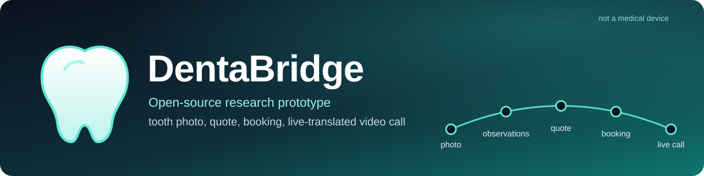
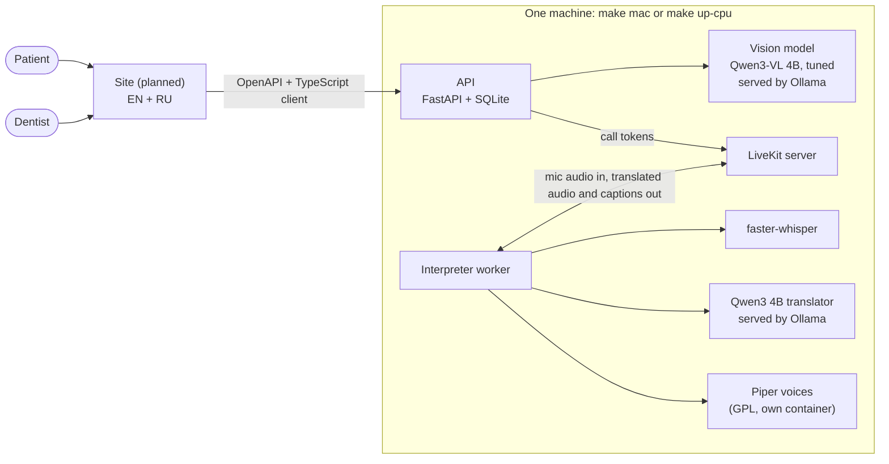

<p align="center">
  
</p>

<p align="center">
  <a href="https://github.com/bogdan734/dentabridge/actions/workflows/ci.yml"></a>
  <a href="LICENSE"></a>
  
  
  
</p>

> [!WARNING]
> **DentaBridge is a research prototype and not a medical device.** It is not a diagnosis, not medical advice and not a substitute for a dentist. Do not use it for diagnosis, treatment or emergencies.

A patient sends a photo of their teeth. An open vision-language model describes what it notices, as observations with regions and never as a verdict, and a small rule table adds an *illustrative* urgency hint. The patient can then get a price quote from a **fictional** clinic (a treatment sample plus flight and hotel estimates), book a **mock** appointment, and join a call room where speech and chat are translated live between English and Russian.

Everything is open source, runs on one laptop, and needs no paid API and no key on the default path.

## How it fits together



## What is in it

- **Observations, not verdicts.** The vision model answers in constrained JSON: findings with regions, each only "possible" or "not seen". A finding is reported as assessed only if it passed a pre-registered release gate; everything else is "not assessed".
- **An urgency hint from rules, not from the model.** A deterministic table over the validated findings stays labelled *illustrative* until a dentist signs a review of that exact file ([how](docs/clinical-review/README.md)).
- **A quote you can inspect.** Treatment sample prices, an offline fare model, hotel tiers and ECB exchange rates, all labelled as estimates. RUB is not offered because the ECB publishes no rate for it.
- **A careful booking flow.** Slots follow the clinic's time zone, daylight-saving changes included. A hold expires after a few minutes or can be released, the same idempotency key books once, and cancelling a booking deletes the observations that were shared with the clinic.
- **A call with live translation.** Voice activity detection, speech to text, translation with a dental glossary, then a synthetic voice. Captions arrive before the audio, and glossary and number checks flag a translation that dropped a term or changed a digit. Chat goes through the same translator and the same checks.
- **Consent and disclosure built in.** The AI-disclosure text must be acknowledged before joining, calls are never recorded, and the dentist sees analysis results only if the patient shared them under a separate consent.
- **Contracts first.** The OpenAPI document, a generated TypeScript client and recorded fixtures live in [`contracts/`](contracts/), so the site can be built against them.

## Quickstart

Needs Docker and [uv](https://docs.astral.sh/uv/).

```bash
git clone https://github.com/bogdan734/dentabridge.git && cd dentabridge
make demo                        # the API in demo mode, in Docker: no models, no LiveKit
curl -s localhost:8000/v1/health
make down
```

The full local path, with a call room and live translation:

```bash
make models    # shows each model's licence and asks before every download
make mac       # API, LiveKit and Piper in Docker; the interpreter runs natively (Ollama must be running)
```

There is no browser UI yet. [`tests/test_deploy.py`](tests/test_deploy.py) drives a whole call through the API with two Python clients: the patient speaks, the dentist reads the caption, hears the translation and receives the translated chat message. `make help` lists every target.

## Measured results

Every number in this section is generated from [`docs/results/`](docs/results/) by `tools/render_readme.py`; a test fails if the README drifts from those files.

### Live voice translation

<!-- results:voice:start -->
Live translation on the `mac-native` profile: 50 scripted turns of an English-speaking dentist and a Russian-speaking patient, recorded 2026-11-02 on Apple M3 Max, 36 GB (load average 13.3 when it started). The audio is synthetic speech from Piper voices, not human recordings.

| | |
|---|---|
| Speech end to first translated audio | median **1.34 s**, 95th percentile 1.54 s |
| Mean time per stage | speech to text 953 ms, translation 320 ms, first audio 68 ms |
| Word error rate of the recognised speech | 10.1 % |
| Translation quality (chrF++ against the reference) | 64.5 |
| Turns whose glossary terms survived | 98 % |
| Turns whose numbers survived | 100 % |

Models: speech to text: faster-whisper small (int8, cpu); translator: qwen3:4b-instruct through Ollama; voices: en_US-ljspeech-medium, ru_RU-denis-medium through Piper.
<!-- results:voice:end -->

This is synthetic speech on a busy laptop with CPU-only models, so read it as an upper bound on what a quiet machine does with real voices, not as a benchmark. Details: [`docs/results/voice.md`](docs/results/voice.md).

### Image model, first run

<!-- results:vision:start -->
First training run, scored on the `val` split (757 images). Share of answers that were valid JSON: tuned 87.2 %, untuned base model 41.9 %. Intervals are 95 % cluster-bootstrap; a dash means the split has no positives or no negatives for that finding.

| Finding | Positives / negatives | Tuned: sensitivity | Tuned: specificity | Untuned: sensitivity | Untuned: specificity |
|---|---|---|---|---|---|
| caries | 302 / 455 | 0.51 (0.45–0.58) | 0.97 (0.96–0.99) | 0.05 (0.03–0.08) | 0.94 (0.91–0.97) |
| filling | 65 / 66 | 0.08 (0.02–0.14) | 0.97 (0.92–1.00) | 0.00 (0.00–0.00) | 1.00 (1.00–1.00) |
| crown | 21 / 110 | 0.00 (0.00–0.00) | 1.00 (1.00–1.00) | 0.00 (0.00–0.00) | 0.99 (0.97–1.00) |
| abrasion | 112 / 19 | 0.92 (0.87–0.96) | 0.05 (0.00–0.20) | 0.00 (0.00–0.00) | 1.00 (1.00–1.00) |
| gingivitis | 0 / 0 | — | — | — | — |
<!-- results:vision:end -->

This is a mixed, honest result. Tuning helped a great deal over the untuned model, but only caries was learned: fillings and crowns were missed, abrasion was reported almost every time, and gingivitis has no validation data in this snapshot, so it is never reported as assessed. A second run with the fixes this one showed was started on 2026-11-02, and nothing from the image model is released until it passes the release gate. Full reports: [tuned](docs/results/ml/run1-tuned.md), [untuned](docs/results/ml/run1-zeroshot.md).

## Status

| Part | State |
|---|---|
| API: analyses, consents, quotes, bookings, calls, replays | Done. OpenAPI, TypeScript client and fixtures are generated and tested. |
| Pricing: fare estimator, hotels, exchange rates | Done. |
| Voice: interpreter worker, chat translation, test harness | Done. Verified end to end against a local LiveKit server. |
| One-command deployment | `make demo` and `make mac` verified. The `cpu` and `cuda` profiles validate but have not been run. |
| Vision model | Run 1 done (above). Run 2, release gate and model card pending. |
| Demo sample photos with precomputed answers | Waiting for the shipped model. |
| Site (EN + RU) and Hugging Face Space | Not started. |

## Limitations

- **Data.** The model is trained and scored on two public photo datasets taken with specific cameras and in specific clinics. How it behaves on a patient's phone photo has not been measured.
- **Few examples for some findings.** The positives and negatives are in the table above. Intervals are wide where the counts are small.
- **Synthetic speech.** The voice numbers come from synthetic voices reading a script, on one machine. Real voices, accents and background noise are untested.
- **Not clinically reviewed.** The urgency table and the English–Russian glossary are illustrative until a dentist reviews them. Machine translation is not a medical interpreter.
- **Fares.** The fare model is calibrated on US domestic fares only; every other route is an extrapolation. Flights and hotels are estimates, treatment prices are samples.
- **Nothing is real.** The clinics are fictional, nothing is paid, and no appointment exists.

It has not been cleared or approved by the FDA, an EU notified body or the MHRA. It makes no claim of FDA, CE, MHRA, HIPAA or GDPR compliance.

## Repository map

| Path | What it holds |
|---|---|
| [`packages/core`](packages/core) | Contracts, ports, the claims linter and the EN/RU patient texts. Everything else imports it. |
| [`packages/ml`](packages/ml) | Data pipeline, training targets, the QLoRA recipe, evaluation and model-serving backends. |
| [`packages/pricing`](packages/pricing) | Offline fare estimator, hotel tiers and the exchange-rate snapshot. |
| [`packages/api`](packages/api) | The FastAPI service. |
| [`packages/voice`](packages/voice) | The interpreter worker, the translation pipeline, the glossary and the measurement harness. |
| [`contracts/`](contracts/) | Generated OpenAPI, TypeScript client and recorded fixtures. |
| [`deploy/`](deploy/) | Compose profiles, Dockerfiles and the LiveKit configuration. |
| [`docs/`](docs/) | [Plan](docs/PLAN.md), [workstreams](docs/workstreams/), [research notes](docs/research/), [results](docs/results/), [licences](docs/licences.md). |

## Development

```bash
uv sync --all-packages --extra stt --extra harness --extra worker
make check     # ruff, mypy --strict, pytest, and the claims linter on the patient texts
make docs      # regenerate the tables in this README and docs/licences.md
```

Every behaviour change ships with a test, and CI runs the same `make check`. The plan, with the contracts each part must keep, is in [`docs/PLAN.md`](docs/PLAN.md).

## Licences and data

The code is [MIT](LICENSE). Every dataset, model, voice and library has a dated row in [`docs/licences.md`](docs/licences.md). In short:

- **Data.** The AKU caries photos ([Zenodo 14827784](https://zenodo.org/records/14827784)) and AlphaDent ([Zenodo 16582489](https://zenodo.org/records/16582489)) are CC BY 4.0. They are downloaded by the user and never redistributed here. A third dataset, Mendeley gingivitis, is downloaded and verified but not used for training or evaluation in this snapshot.
- **Models.** Qwen3-VL-4B-Instruct and Qwen3-4B-Instruct (Apache-2.0), faster-whisper small and Silero VAD (MIT), Piper voices trained on public-domain and CC0 data.
- **Copyleft stays out of process.** Piper (GPL-3.0) runs in its own container and is reached over HTTP only.
- **Pricing data.** OurAirports (public domain) and ECB reference rates.

## Author

Built by [Bohdan Havryliuk](https://github.com/bogdan734). A dentist's review of the urgency table and the glossary would help most; see [`docs/clinical-review`](docs/clinical-review/README.md).
